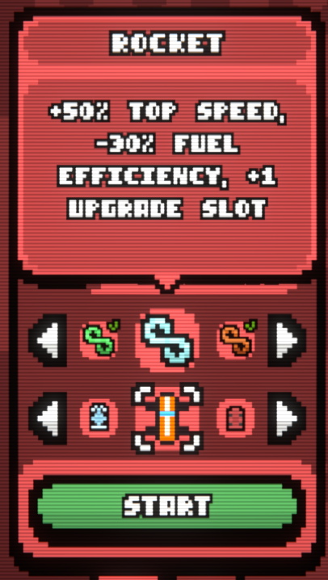
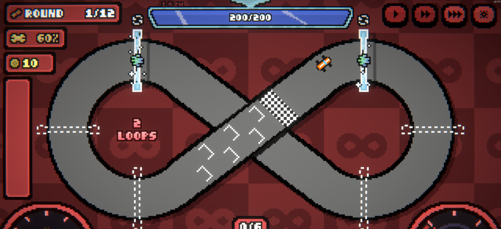

# Loopler Car Loader

Adds new cars to The Loopler (BepInEx 6, IL2CPP). Each car is one JSON file, optionally with a PNG
sprite next to it. Every file in the cars folder is read when the game starts, and the cars appear in
the car select after the game's own nine.

| Car select | On the track |
| --- | --- |
|  |  |

```json
{
  "id": "rocket",
  "name": "Rocket",
  "effect": "+50% top speed, -30% fuel efficiency, +1 upgrade slot",
  "base": "Durabler",
  "sprite": "rocket.png",
  "durability": 60,
  "stats": { "TopSpeed": 1.5, "FuelEfficiency": 0.7 },
  "bonusUpgradeSlots": 1
}
```

## Install

1. Install [BepInEx 6 (IL2CPP, x64)](https://builds.bepinex.dev/projects/bepinex_be) into the game folder and start the game once.
2. Download a zip from the [latest release](https://github.com/HiveSolution/loopler-car-loader/releases/latest) and extract it into the game folder:
   - `LooplerCarLoader-v1.0.1.zip`: the framework only. Pick this one to play car mods made by others.
   - `LooplerCarLoader-v1.0.1-with-examples.zip`: the framework plus the two [example cars](examples/), to try it out or as a start for your own.
3. Put car files into `<game>\BepInEx\config\LooplerCars\` (the folder is created on the first start).

Tested with BepInEx 6.0.0-be.788 on The Loopler built with Unity 6000.3.16f1.

## Making a car

One `.json` file per car, anywhere inside `LooplerCars\` (subfolders are fine, e.g. one folder per car
with its sprite). Comments and trailing commas are allowed. A file with an error is skipped and the
reason is written to `<game>\BepInEx\LogOutput.log`, so check there if a car doesn't show up.

| Field | Default | What it does |
| --- | --- | --- |
| `id` | required | Unique name of the car, used in saves. Don't change it once people drive the car. |
| `name` | required | Shown in the car select and the garage. |
| `effect` | empty | The description under the name. |
| `base` | `Durabler` | The game's car this one starts from: its look, durability and trigger. Also the car a saved run falls back to if this car is removed. One of `Durabler`, `Goldler`, `Slotler`, `Ghostler`, `Driftler`, `Rockler`, `Clovler`, `Tankler`, `Freezler`. |
| `keepBaseAbility` | `false` | `true` keeps the base car's special ability (e.g. Slotler's extra slot and gate checkpoint). `false` gives a car without one. |
| `sprite` | base's sprite | PNG file, relative to the JSON file. Shown in the car select, the garage and on the track. |
| `durability` | base's | Maximum and starting durability. |
| `stats` | none | Multipliers on the car's base stats, by stat name. `1.5` is +50%, `0.7` is -30%. |
| `bonusUpgradeSlots` | `0` | Extra upgrade slots, added to the 5 every car has (and to the base ability's, if kept). |
| `extraGateCheckpoint` | `false` | `true` gives the car an extra gate checkpoint, like Slotler. |

Stat names for `stats`: `TopSpeed`, `Acceleration`, `DriftGrip`, `Durability`, `FuelCapacity`,
`FuelEfficiency`, `RefuelEfficiency`, `BoostCap`, `GlobalBoostGain`, `BoostDecay`, `LuckChance`,
`DriftTrigger`, `GlobalScoreMult`, `BaseLoopScore`, `CardRetriggerChance`, `OverdriveBoost`,
`OverdriveTimer`, `OverdriveBoostTime`, `CardSellValue`, `UpgradeCostReduction`, `Inheritance`,
`BlueprintChance`, `GhostLongevity`, `GhostSpeed`, `GateCooldown`, `FrozenThreshold`.

### Sprites

The game's car sprites are **11 x 11 pixels**, top-down with the car pointing up. Use the same size so
yours matches them. Save as an 8-bit PNG (RGBA, RGB or indexed with a palette, not interlaced), which
is what pixel art editors like Aseprite export by default. Without a sprite the car uses its base
car's.

### Sharing your cars

Release only your own files, in their own folder, as `BepInEx\config\LooplerCars\<your-mod>\`
inside the zip, so players extract it into the game folder like any BepInEx mod. Don't include the
framework's DLL: list Loopler Car Loader as a requirement and link this page instead. Each `id` must
be unique across every car a player has installed, so prefix yours (`yourname-rocket`).

## Saves and removing cars

- **Removing the mod or a car is safe.** The game's save only ever holds the base car; the modded
  car's id is kept in `<game>\BepInEx\config\LooplerCarLoader.run.txt`. Without the mod (or the car),
  a saved run continues with the base car instead.
- **Modded cars have no progress of their own.** They're always unlocked, show no completion badges,
  and a run with one doesn't count towards the base car's wins either.

## Leaderboards

Runs with a modded car are **not uploaded to the game's leaderboards**, so they can't mix with
normal runs. Runs with the game's own cars are unaffected.

## Build

Needs the .NET SDK (6 or newer) and a game install with BepInEx that has been started once, because
the build references the generated assemblies in `BepInEx\interop`. They are regenerated after every
game update; rebuild after that.

```
dotnet build LooplerCarLoader.csproj -c Release -p:Deploy=true
dotnet run --project tests\PngCheck
```

`Deploy=true` copies the DLL into the game (close the game first, it locks the file). The game folder
defaults to the path in `LooplerCarLoader.csproj`; override it with `-p:GameDir="..."` or the
`LOOPLER_GAME_DIR` environment variable. The second command checks the PNG reader.

## Layout

- `src/Plugin.cs`: BepInEx entry point, reads the car folder.
- `src/CarFile.cs`: the JSON format, its checks, and loading a sprite.
- `src/Png.cs`: a small PNG reader (Unity 6's own image loading can't be called from a mod).
- `src/Patches.cs`: adds the cars to the game and hooks the car select, stats, run start, profile and leaderboards.
- `src/CarouselFix.cs`: redraws the car select's slots each time it settles.
- `tests/PngCheck/`: checks the PNG reader against the example sprite.
- `tools/drive.ps1`: helpers to send input to the running game and take screenshots, for testing.

## License

Copyright (c) 2026 [RenokK/HiveSolution](https://github.com/HiveSolution). Licensed under
[CC BY-NC 4.0](LICENSE.txt): source available, not open source. You may share and modify it for
noncommercial purposes with attribution; commercial use, including reselling or bundling it into
commercial products, is not permitted. Car files you make are yours.
